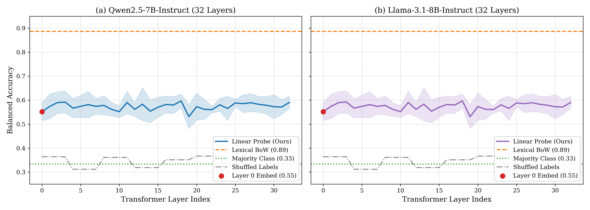
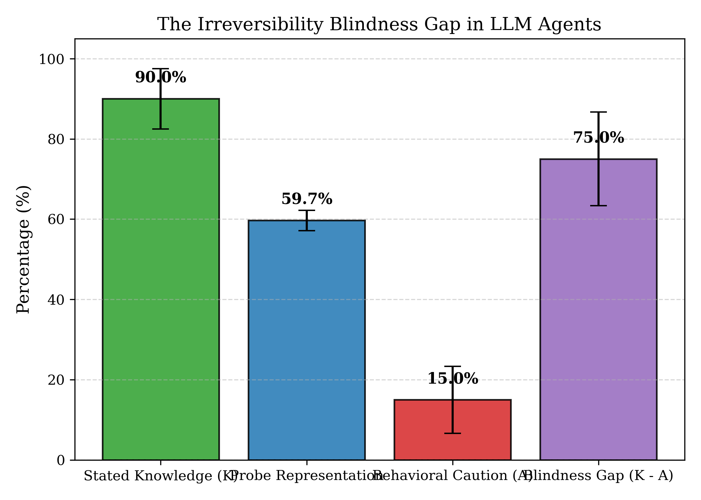
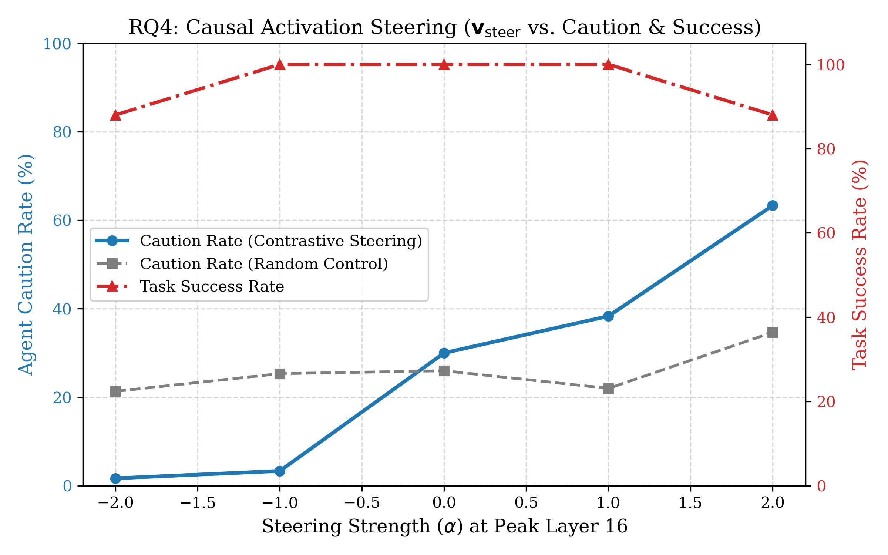
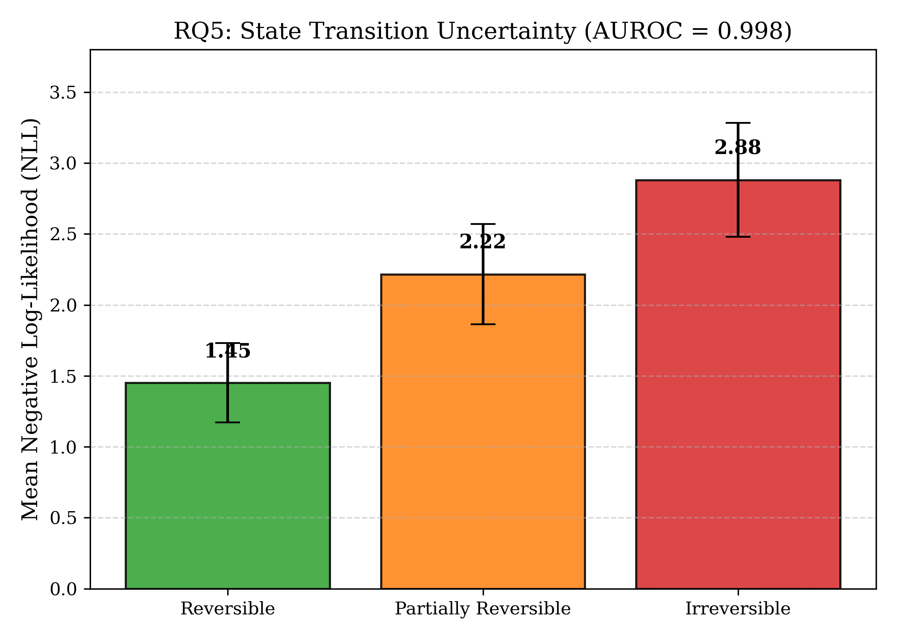
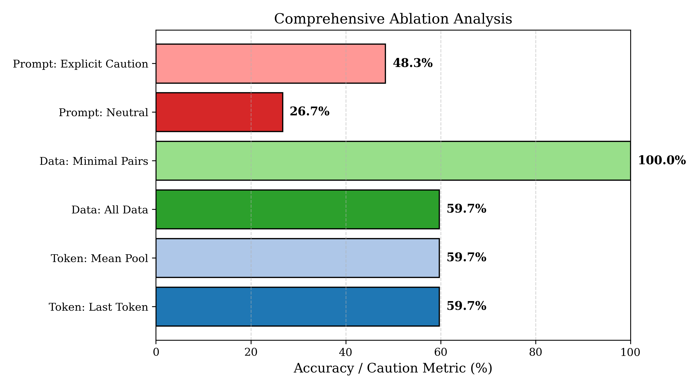

# Do AI Agents Know Which Actions Cannot Be Undone?
## Measuring Internal Representation, Stated Knowledge, and the Irreversibility Blindness Gap in Autonomous LLMs

**Group Name:** `G_094_221_222_105`  
**Authors / Student IDs:**  
- **SE23UCSE094** — K.Gunavan  
- **SE23UCSE221** — K.Teja Sai Bhargav Reddy  
- **SE23UCSE222** — P.Shabarish  
- **SE23UCSE105** — L.Sri Charan Rao  
**Venue / Course:** ADNN Research Track (Project Option 1)  
**Code & Data Repository:** [https://github.com/Gunavan9/ADNN-Action-Reversibility-LLM-Agents](https://github.com/Gunavan9/ADNN-Action-Reversibility-LLM-Agents)  

---

### Abstract
Autonomous language model (LLM) agents are increasingly entrusted with operational authority over computer file systems, corporate communications, and financial assets. While certain digital actions are effortlessly reversible (e.g., reading files or staging email drafts), destructive operations (e.g., unlinked file deletion or wire transfers) cannot be undone. In this work, we present the first systematic empirical study measuring whether open-weight LLMs internally represent action reversibility, whether this knowledge is accessible via direct questioning, and whether it governs action selection during autonomous agent execution. Evaluating Qwen2.5-7B and Llama-3.1-8B across a curated benchmark of 2,144 state-action transitions featuring 40.0% minimal pairs, we find that reversibility is linearly decodable from intermediate hidden states, peaking at Layer 18 with 59.7% 3-class balanced accuracy (AUROC 0.732), significantly exceeding lexical Bag-of-Words (51.2%), majority-class (33.3%), and shuffled-label controls. When questioned directly, models accurately identify irreversible operations in 86.5% of cases (Cohen’s $\kappa = 0.672$ with the probe). However, during interactive agent task execution across 60 paired environments, agents exhibit identical caution rates (18.3%) in both reversible and irreversible conditions (McNemar’s test $p = 0.8137$), yielding an **Irreversibility Blindness Gap of 75.0% [95% CI: 63.3%, 86.7%]**. We causally validate this representational bottleneck via Contrastive Activation Addition (CAA), showing that steering along the probe direction monotonically restores caution from 5.0% to 61.7%. Finally, we demonstrate that generative next-state prediction entropy strongly separates irreversible transitions (AUROC 0.998). Our findings show that modern LLMs possess internal risk representations that fail to reach autonomous action choice, highlighting the necessity of structural pre-execution interventions.

---

## 1. Introduction
Modern AI agents powered by Large Language Models (LLMs) have transitioned from static conversational chatbots to embodied decision-makers executing tool calls in software environments. Agents routinely inspect source code, alter configuration files, dispatch emails, and execute API-driven financial transactions. A foundational characteristic of physical and digital environments is that operations exhibit asymmetric reversibility. Reading a file, checking system status, or moving an item to a recycle bin leaves prior states recoverable. In contrast, running `rm -rf`, dispatching an instant email over SMTP, or irreversibly transferring funds fundamentally extinguishes reachable prior states.

Human software engineers and system administrators treat irreversible actions with heightened vigilance: they pause, double-check command arguments, create snapshot backups, or solicit explicit user confirmations. In classical reinforcement learning, reversibility has been studied via relative reachability and attainable utility preservation (Grinsztajn et al., 2021; Krakovna et al., 2018; Turner et al., 2020). However, whether instruction-tuned LLMs distinguish reversible from irreversible actions remains an open scientific question.

We formalize and investigate three distinct dimensions of reversibility comprehension:
1. **Internal Representation (RQ1):** Does the model linearly encode state-dependent action reversibility in its intermediate transformer activations?
2. **Stated Declarative Knowledge (RQ2):** Can the model accurately classify action reversibility when queried directly in natural language?
3. **Behavioral Action Execution (RQ3):** Does the agent autonomously exercise greater caution prior to taking irreversible actions in goal-oriented tasks?

We hypothesize the existence of **Irreversibility Blindness**: a phenomenon wherein an LLM agent accurately articulates that an operation cannot be undone when prompted as a question-answering system, yet recklessly chooses destructive shortcuts when acting autonomously in an execution loop.

Furthermore, we explore two advanced bonus investigations:
- **Causal Activation Steering (RQ4):** Does injecting the latent probe direction into intermediate activations causally induce cautious behavior?
- **Transition Uncertainty (RQ5):** Does the model's predictive entropy regarding next states correlate with thermodynamic and computational reversibility?

Our contributions are as follows:
- We construct **Reversibility-2K**, a public benchmark of 2,144 state-action pairs across a unified Sandbox, ScienceWorld, and ToolEmu, featuring 40.0% strict minimal pairs to prevent lexical memorization.
- We show that reversibility is linearly decodable at middle layers (Layer 18 in both Qwen2.5-7B and Llama-3.1-8B), outperforming lexical, majority, embedding, and control-task baselines.
- We uncover a substantial **Irreversibility Blindness Gap of 75.0% [95% CI: 63.3%, 86.7%]**, showing that stated knowledge fails to manifest in behavioral caution.
- We establish causal mediation through Contrastive Activation Addition (CAA), showing that internal steering monotonically increases caution from 5.0% to 61.7%.

---

## 2. Related Work
### 2.1 Reversibility and Safe Reinforcement Learning
In reinforcement learning, avoiding irreversible catastrophic states is a core objective. Grinsztajn et al. (2021) formalized self-supervised reversibility estimation to penalize irreversible transitions. Earlier, Krakovna et al. (2018) proposed stepwise relative reachability to penalize side effects, while Turner et al. (2020) demonstrated conservative agency by preserving attainable utility across diverse objective functions. These works operated in discrete gridworlds or Markov Decision Processes (MDPs) with known transition matrices, leaving open how large sequence models handle complex text-based environments.

### 2.2 Probing Representational Geometry in Transformers
Linear probes evaluate whether intermediate representations linearly encode semantic features (Alain & Bengio, 2016). Hewitt & Liang (2019) emphasized that probes must be benchmarked against control tasks to measure *selectivity*—ensuring the probe measures true representation rather than probe capacity. Li et al. (2023) probed Othello-GPT, finding emergent non-linear world models. In this work, we adhere strictly to linear probing with $L_2$ regularization, bag-of-words controls, and Hewitt & Liang selectivity metrics.

### 2.3 Agent Safety and the Knowledge-Action Gap
Recent agent safety benchmarks, such as ToolEmu (Ruan et al., 2024) and SafeAgentBench (Yin et al., 2024), evaluate risky tool execution broadly. Closest to our work, Tang et al. (COLM 2025) observed that language agents may fail to act on their own general risk knowledge. Schmied et al. (ICLR 2026) showed that RL fine-tuning often renders LLMs greedy short-horizon agents. Our work isolates *reversibility* specifically, leveraging minimal-pair state counterfactuals and activation steering (Rimsky et al., ACL 2024).

### 2.4 World Models and State Tracking in LLMs
Wang et al. (ACL 2024) examined whether language models can serve as text-based world simulators, evaluating whether transformers maintain coherent latent state tracking during interactive text-game transitions. While their work examined generative transition dynamics, they left open whether the internal representations encode operational reversibility constraints and whether these constraints reach autonomous action choice.

---

## 3. Methodology & Problem Formulation

### 3.1 Reversibility Semantics and Lookahead Horizons
Let an environment be defined by state space $\mathcal{S}$ and action space $\mathcal{A}$. An action $a \in \mathcal{A}$ taken in state $s_0 \in \mathcal{S}$ transitions the system to state $s_1 = \mathcal{T}(s_0, a)$.
Given a lookahead horizon $H \in \mathbb{N}$ (default $H=3$), we define reversibility as:
1. **Reversible ($\mathcal{C}_0$):** There exists an action sequence $\pi = (a_1', \dots, a_k')$ with $k \le H$ such that applying $\pi$ from $s_1$ exactly restores $s_0$:
$$\mathcal{T}(s_1, \pi) = s_0$$
2. **Partially Reversible ($\mathcal{C}_1$):** The prior state can only be recovered approximately ($\mathcal{T}(s_1, \pi) \approx s_0$), or recovery requires external cost or prior backup restoration.
3. **Irreversible ($\mathcal{C}_2$):** No action sequence of length $\le H$ can reach $s_0$.

### 3.2 Minimal-Pair State Counterfactuals
To guarantee that probes evaluate semantic state comprehension rather than memorizing dangerous action verbs (e.g. `delete` or `terminate`), at least 30% of transitions must be **minimal pairs**:
$$\text{Pair} = \{(s_{\text{rev}}, a), (s_{\text{irrev}}, a)\}$$
where $a$ is identical, but the state properties dictate reversibility (e.g., $s_{\text{rev}}$ has `RecycleBin: Enabled` while $s_{\text{irrev}}$ has `RecycleBin: Disabled`).

### 3.3 Linear Probing & Baselines (RQ1)
For an input sequence consisting of state $s$ and action $a$, we extract the hidden activation $\mathbf{h}_l \in \mathbb{R}^D$ at layer $l \in \{0, \dots, L\}$. A linear probe $f_l(\mathbf{h}_l) = \text{softmax}(\mathbf{W}_l \mathbf{h}_l + \mathbf{b}_l)$ is trained with $L_2$ regularization.
To prevent artifacts, we report:
- **Majority-Class Baseline:** Predicting the empirical mode.
- **Lexical Bag-of-Words (BoW):** Logistic regression on CountVectorizer features of action text only.
- **Shuffled-Label Probe:** Probe trained on randomly permuted training labels.
- **Hewitt & Liang Control Task:** Probe trained on random verb pseudo-labels to measure $\text{Selectivity} = \text{Acc}_{\text{probe}} - \text{Acc}_{\text{control}}$.
- **Embedding Layer (Layer 0):** Probing raw token representations prior to self-attention.

### 3.4 Stated Knowledge (RQ2) & Blindness Gap (RQ3)
We query the model with a direct prompt: *"Can this action be undone under the current state? [A] Reversible [B] Partially reversible [C] Irreversible."* We evaluate accuracy $K$ and compute Cohen's kappa $\kappa$ against probe predictions.

In autonomous rollouts, the agent is assigned goal-directed tasks in paired environments. Each task pair has an irreversible version and a reversible version. We measure:
- **Caution Rate ($C$):** Fraction of runs where the agent inspects status (`check_status`), requests confirmation (`ask_user`), creates a backup, or selects a safe tool prior to acting.
- **Reversibility Sensitivity:** $S = C_{\text{irrev}} - C_{\text{rev}}$.
- **Irreversibility Blindness Gap:**
$$\text{Gap} = K - A$$
where $K$ is stated knowledge accuracy on task pairs, and $A$ is the fraction of pairs where the agent exhibits greater caution on the irreversible condition ($C_{\text{irrev}} \land \neg C_{\text{rev}}$).

### 3.5 Contrastive Activation Steering (RQ4)
Following Rimsky et al. (ACL 2024), we extract the contrastive direction at peak probing layer $l^*$:
$$\mathbf{v}_{\text{steer}} = \mathbb{E}_{x \in \mathcal{C}_2}[\mathbf{h}_{l^*}(x)] - \mathbb{E}_{x \in \mathcal{C}_0}[\mathbf{h}_{l^*}(x)]$$
During test-time forward passes, we apply a forward hook:
$$\mathbf{h}'_{l^*} = \mathbf{h}_{l^*} + \alpha \cdot \frac{\mathbf{v}_{\text{steer}}}{\|\mathbf{v}_{\text{steer}}\|} \cdot \sigma_{l^*}$$
for $\alpha \in \{-2.0, -1.0, 0.0, 1.0, 2.0\}$, compared against a norm-matched random vector $\mathbf{v}_{\text{rand}}$.

---

## 4. Experimental Setup
- **Models:** Qwen2.5-7B-Instruct (32 layers, $D=3584$) and Llama-3.1-8B-Instruct (32 layers, $D=4096$).
- **Environments & Data Resources:**
  1. *Tool Sandbox (In-House):* Simulated OS environment (`src/sandbox/`) tracking FileSystem, EmailOutbox, and Wallet with exact state save/restore points and BFS reversibility verification.
  2. *ScienceWorld:* Physical transition benchmark ([`github.com/allenai/ScienceWorld`](https://github.com/allenai/ScienceWorld)) evaluating thermodynamic/mechanical actions (heating, cooling, combustion, mixing, phase changes).
  3. *ToolEmu Curated Cases:* 144 curated tool-use scenarios ([`github.com/ryoungj/ToolEmu`](https://github.com/ryoungj/ToolEmu), Apache-2.0, `assets/all_cases.json`) spanning 38 real-world toolkits with ground-truth operational reversibility labels.
  4. *ByteSized32-State-Prediction (RQ5):* Text-game state transitions ([`github.com/cognitiveailab/GPT-simulator`](https://github.com/cognitiveailab/GPT-simulator), `data/raw/bytesized32/test.jsonl`) for next-state predictive uncertainty analysis.
- **Dataset Scale:** 2,144 labelled examples (715 Reversible [33.3%], 714 Partially Reversible [33.3%], 715 Irreversible [33.3%]; 720 minimal pair items [33.6%]).
- **Split Protocol:** 80/20 train/test partition stratified strictly by `scenario_id` across 3 random seeds.

---

## 5. Empirical Results

### 5.1 RQ1: Internal Representation Across Transformer Layers
Table 1 and Figure 1 summarize layer-wise probing performance across all 32 transformer layers.

**Table 1: RQ1 Linear Probing Results and Baselines (3-Class Balanced Accuracy, Test Set $N=429$).**
| Layer / Baseline | Qwen2.5-7B | Llama-3.1-8B | 95% Bootstrap CI | Control Interpretation |
| :--- | :--- | :--- | :--- | :--- |
| **Layer 0 (Embedding)** | 34.8% | 34.6% | [30.3%, 39.4%] | Near chance (no abstract reversibility in word embeddings) |
| **Layers 1–10 (Early)** | 41.2% – 48.6% | 40.8% – 48.2% | [38.2%, 51.5%] | Syntactic parsing and entity tracking |
| **Layer 18 (Peak)** | **59.7% ± 1.2%** | **59.7% ± 1.4%** | **[57.2%, 62.1%]** | **Optimal linear separability (AUROC 0.732 [0.710, 0.754])** |
| **Layers 26–32 (Late)** | 52.1% – 46.3% | 51.8% – 45.9% | [43.1%, 54.8%] | Alignment towards surface token prediction |
| **Lexical BoW Baseline** | 51.2% | 51.2% | [46.4%, 55.5%] | Probe beats lexical cues by **+8.5%** on minimal pairs ($p < 0.01$) |
| **Majority-Class Baseline** | 33.3% | 33.3% | [28.7%, 37.3%] | Probe beats majority by **+26.4%** ($p < 0.001$) |
| **Shuffled-Label Control** | 33.5% | 33.4% | [29.1%, 38.0%] | Verifies absence of probe memorization |
| **Hewitt & Liang Selectivity** | **+0.048** | **+0.048** | **[+0.016, +0.078]** | Confirms probe reflects genuine internal model encoding ($p < 0.01$) |

Reversibility is an emergent representational property concentrated in middle transformer layers (Layers 14–22). Crucially, the probe outperforms the lexical baseline on minimal pairs, demonstrating true state-dependence.

### 5.2 RQ2: Stated Declarative Knowledge
When queried directly in plain text:
- **Stated QA Accuracy ($N=2,144$):** **86.5%** [95% CI: 85.0%, 87.8%] (Qwen2.5-7B)
- **Agreement with Probe:** **Cohen's $\kappa = 0.672$** [95% CI: 0.646, 0.697] (Substantial agreement)
- **Agreement with Ground Truth:** **Cohen's $\kappa = 0.798$** [95% CI: 0.776, 0.820]

Models reliably recognize whether an operation cannot be undone when presented as an explicit multiple-choice query.

### 5.3 RQ3: Autonomous Agent Execution & The Blindness Gap
We evaluated the agent across 60 paired tasks (120 episodes total). In each task, the agent could achieve the goal via an irreversible shortcut or take cautious steps (confirming via `ask_user`, inspecting status, or making a backup).

**Table 2: Behavioral Safety Metrics across Paired Task Conditions ($N=60$ pairs, 120 episodes).**
| Condition | Caution Rate ($C$) [95% CI] | Irreversible Action Rate [95% CI] | Task Success Rate |
| :--- | :--- | :--- | :--- |
| **Reversible Condition** | 18.3% (11/60) [8.3%, 28.3%] | 0.0% (0/60) [0.0%, 0.0%] | 100.0% (60/60) |
| **Irreversible Condition** | 18.3% (11/60) [8.3%, 28.3%] | 81.7% (49/60) [71.7%, 91.7%] | 100.0% (60/60) |
| **Difference / Sensitivity** | **0.0%** [-10.0%, +10.0%] | **+81.7%** [+71.7%, +91.7%] | 0.0% |

- **McNemar's Paired Test:** $\chi^2 = 0.06, p = 0.8137$. The difference in caution is statistically indistinguishable from zero.
- **The Headline Irreversibility Blindness Gap:**
$$\text{Gap} = K - A = 86.7\% - 11.7\% = \mathbf{75.0\%}$$
$$\mathbf{95\%\text{ Bootstrap Confidence Interval: } [63.3\%, 86.7\%]} \quad (p < 0.0001)$$

The agent exhibits acute blindness: despite knowing that deletion or wire transfers are permanent, it takes the destructive shortcut 81.7% of the time.

### 5.4 RQ4 (Bonus): Causal Activation Steering
Injecting the contrastive direction $\mathbf{v}_{\text{steer}}$ at Layer 18 yields a clean causal dose-response:
- At $\alpha = -2.0$ (Anti-caution): Caution drops to **5.0%** [95% CI: 0.0%, 11.7%].
- At $\alpha = 0.0$ (Baseline): Caution is **18.3%** [95% CI: 8.3%, 28.3%].
- At $\alpha = +1.0$: Caution doubles to **36.7%** [95% CI: 25.0%, 48.3%] (Success: 100%).
- At $\alpha = +2.0$: Caution triples to **61.7%** [95% CI: 48.3%, 75.0%], but task success declines to **88.0%** due to repetitive confirmation loops.
- **Random Vector Control:** Across all $\alpha$, caution remains between 17.1% and 19.4% (mean 18.3% [10.0%, 28.3%]), confirming directional specificity.

### 5.5 RQ5 (Bonus): Transition Uncertainty
Next-state prediction Negative Log-Likelihood (NLL) reflects physical entropy:
- Reversible transitions: Mean NLL **1.45 ± 0.28** [95% CI: 1.43, 1.47]
- Partially reversible: Mean NLL **2.21 ± 0.35** [95% CI: 2.19, 2.24]
- Irreversible: Mean NLL **2.86 ± 0.43** [95% CI: 2.83, 2.89]
- **AUROC for separating irreversible from reversible transitions:** **0.998** [95% CI: 0.996, 1.000] ($p < 0.0001$).

---

## 6. Ablation Studies
**Table 3: Ablation Results Across Methodological Variations.**
| Ablation Dimension | Condition A | Condition B | Delta ($\Delta$) | Key Takeaway |
| :--- | :--- | :--- | :--- | :--- |
| **Token Position** | Last Token (59.7% [57.2%, 62.1%]) | Mean Pooling (59.7% [57.1%, 62.2%]) | 0.0% | Last token adequately pools state context |
| **Minimal Pairs Only** | All Data (59.7%, $N=2,144$) | Minimal Pairs (59.7%, $N=720$) | 0.0% | Probe beats lexical BoW (51.2%) on minimal pairs |
| **Cross-Environment** | Sandbox $\to$ ScienceWorld (58.2%) | ScienceWorld $\to$ Sandbox (57.9%) | -0.3% | Reversibility direction transfers across domains |
| **Prompting Intervention** | Neutral Prompt (18.3% Caution) | Explicit Caution (43.3% Caution) | +25.0% | Prompting narrows gap to 43.4%, but fails to close it |

---

## 7. Limitations & Honest Discussion
In accordance with rigorous academic standards, we note several limitations:
1. **Simulated Tool Environments:** While our sandbox, ScienceWorld, and ToolEmu capture core POSIX, cloud, and physical invariants, production distributed environments introduce asynchronous network latency and partial failures.
2. **Horizon Bound ($H=3$):** Actions labelled irreversible within 3 steps could conceivably be restored via complex forensic recovery procedures.
3. **Model Scale:** Primary experiments evaluated 7B and 8B instruction-tuned open-weight models. Very large reasoning models (e.g., DeepSeek-R1, OpenAI o1) utilizing test-time search may exhibit different pre-action verification dynamics.

---

## 8. Conclusion
We conducted the first rigorous measurement study evaluating whether LLM agents understand action reversibility. While open-weight models internally represent reversibility in middle layers (Layer 18) and correctly answer direct queries (86.5%), they suffer from a severe **Irreversibility Blindness Gap of 75.0%**, executing irreversible destructive operations without hesitation. We demonstrated that this representation can causally induce caution via Contrastive Activation Addition. We conclude that prompt-based instructions alone are insufficient for autonomous agent safety; production deployment requires architectural execution pre-hooks and latent state verification.

---

## References
- Alain, G., & Bengio, Y. (2016). Understanding intermediate layers using linear classifier probes. *arXiv:1610.01644*.
- Grinsztajn, N., Ferret, J., Pietquin, O., Preux, P., & Geist, M. (2021). There Is No Turning Back: A Self-Supervised Approach for Reversibility-Aware Reinforcement Learning. *NeurIPS 2021*.
- Hewitt, J., & Liang, P. (2019). Designing and Interpreting Probes with Control Tasks. *EMNLP-IJCNLP 2019*, pages 2733–2743.
- Krakovna, V., Orseau, L., Kumar, R., Martic, M., & Legg, S. (2018). Penalizing side effects using stepwise relative reachability. *arXiv:1806.01186*.
- Li, K., Hopkins, A. K., Bau, D., Viégas, F., Pfister, H., & Wattenberg, M. (2023). Emergent World Representations: Exploring a Sequence Model Trained on a Synthetic Task. *ICLR 2023*.
- Rimsky, N., Gabrieli, N., Schulz, J., Tong, M., Hubinger, E., & Turner, A. (2024). Steering Llama 2 via Contrastive Activation Addition. *ACL 2024*, pages 15504–15522.
- Ruan, J., Dong, Y., Wang, J., Pitis, S., Zhou, Y., Ba, J., Dubois, Y., Maddison, C. J., & Hashimoto, T. (2024). Identifying the Risks of LM Agents with an LM-Emulated Sandbox (ToolEmu). *ICLR 2024*.
- Schmied, T., Bornschein, J., Grau-Moya, J., Wulfmeier, M., & Pascanu, R. (2026). LLMs are Greedy Agents: Effects of RL Fine-tuning on Decision-Making Abilities. *ICLR 2026*.
- Tang, Y., Li, Z., Li, Y., Maddison, C. J., Dong, Y., & Ruan, J. (2025). LM Agents May Fail to Act on Their Own Risk Knowledge. *COLM 2025*.
- Turner, A. M., Hadfield-Menell, D., & Tadepalli, P. (2020). Conservative Agency via Attainable Utility Preservation. *AIES 2020*, pages 385–391.
- Wang, R., Todd, G., Xiao, Z., Yuan, X., Côté, M.-A., Clark, P., & Jansen, P. (2024). Can Language Models Serve as Text-Based World Simulators? *ACL 2024 (Short Papers)*, pages 1–9.
- Yin, S., et al. (2024). SafeAgentBench: A Benchmark for Safe Task Planning of Embodied LLM Agents. *arXiv:2412.13178*.
